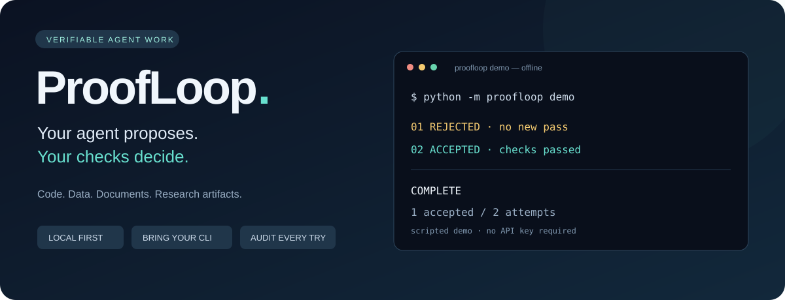
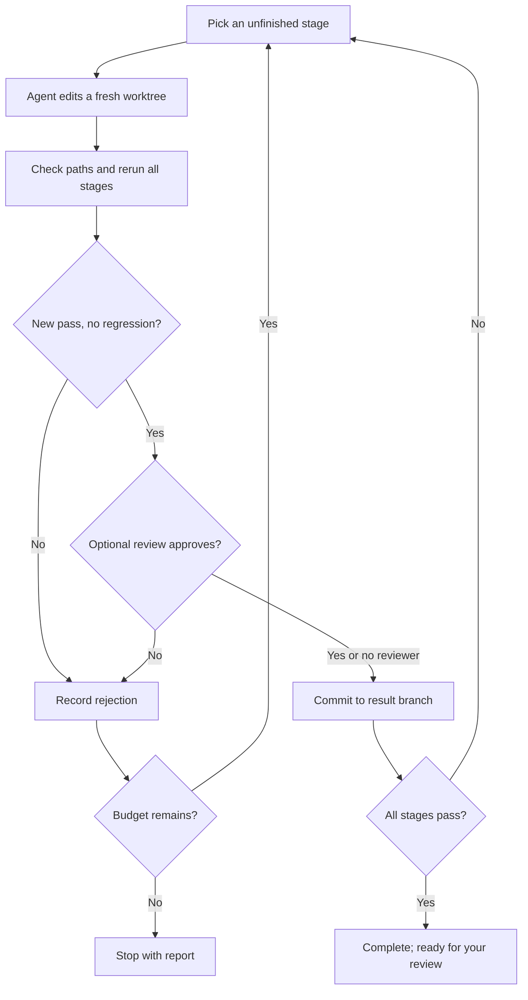

<p align="center"></p>

<p align="center">
  <a href="https://github.com/IreneXiaooo/proofloop/actions"></a>
  <a href="LICENSE"></a>
  
  
  
</p>

# ProofLoop

**Your agent proposes. Your checks decide.**

A small harness that gives an agent a task, checks its work, and keeps changes only when they pass a new acceptance stage without breaking an existing one. Every attempt leaves a prompt, logs, a patch, and a decision you can inspect.

Use it for code fixes, data transformations, document generation, and research pipelines with executable acceptance checks. Bring your own agent command. Start with the offline demo—no API key required.

```text
Attempt 1 · behavior · executing
Attempt 1 · verifying all stages
Attempt 1 · REJECTED · NO_NEW_PASS
Attempt 2 · behavior · executing
Attempt 2 · verifying all stages
Attempt 2 · ACCEPTED · NEW_PASS_NO_REGRESSION

COMPLETE · 1 accepted / 2 attempts
```

<sup>Actual output from the included scripted demo. It demonstrates the controller, not LLM performance.</sup>

## Try it in a minute

Requires Python 3.11+ and Git. From this checkout:

```bash
python -m proofloop demo
```

The demo creates a separate tiny Git repository, submits an incorrect fix, rejects it, and then accepts a correct fix on `proofloop/fix-mean`. The initial checkout stays as it was.

```bash
# Inspect exactly what was kept
 git -C .proofloop-demo diff main..proofloop/fix-mean

# Read decisions, checks and counters
python -m proofloop report .proofloop-demo/task.json --repo .proofloop-demo
```

For use from other directories, install this checkout:

```bash
python -m pip install -e .
proofloop --help
```

No hosted service, database, provider SDK, or runtime dependency is required. Source repository: [IreneXiaooo/proofloop](https://github.com/IreneXiaooo/proofloop). This alpha is installed from source; no PyPI release is claimed.

## Codex: Astra + Sol

**New in 0.2:** built-in Codex CLI adapters, separate models for worker/reviewer/planner, bounded sequential delegation, mixed-provider command workers, and token usage reports.

```bash
python -m pip install -e .
proofloop init-codex --dir my-task --worker-model gpt-6.1-sol --reviewer-model gpt-6-astra
proofloop doctor my-task/task.json --repo my-task
proofloop run my-task/task.json --repo my-task
proofloop usage my-task/task.json --repo my-task
```

Install and authenticate Codex first. Add `--planner-model gpt-6-astra` to the setup command to enable bounded planning/delegation. Models must be available to your account. Setup and `doctor` make no model calls; `run` can consume your allowance.

[Codex setup, delegation, and usage →](docs/codex.md)

<sup>CLI contract tested with a simulated Codex process. Live Astra/Sol validation remains pending.</sup>

## What you get

| Feature | What it does |
| --- | --- |
| **Verified progress** | Accepts a candidate only when at least one new stage passes and all previously passing stages still pass. |
| **Isolated attempts** | Runs each attempt in a detached Git worktree; accepted changes accumulate on a result branch. |
| **Frozen boundaries** | Rejects changes outside your writable globs or inside protected globs. Freeze your tests, task file, and verifier dependencies. |
| **Optional review gate** | A separate command can approve or reject after checks pass. Missing or malformed review fails closed. |
| **Bounded execution** | Caps attempts, active wall time, repeated failures, and each subprocess. |
| **Resume and inspect** | Persists state, detects configuration drift, and writes a Markdown run report. |
| **Private by default** | Runs locally; the harness itself makes no API calls, uploads, pushes, or merges. Your configured commands may use external services. |

## Put your own agent in the loop

1. Commit your project and acceptance checks. Start with a clean checkout.
2. Write `task.json`. Choose exactly which output paths the agent can change.
3. Point `agent.command` at a wrapper for your installed coding agent or local program.
4. Run, inspect, and merge the result when you are satisfied.

```json
{
  "version": 1,
  "id": "fix-parser",
  "goal": "Parse quoted CSV fields and reject malformed rows. Preserve the public API.",
  "agent": {
    "command": ["{python}", "agent_wrapper.py"],
    "timeout_s": 600
  },
  "writable": ["src/**"],
  "protected": ["tests/**", "checks/**", "task.json", "agent_wrapper.py"],
  "stages": [
    {"id": "quoted-fields", "check": ["{python}", "-m", "unittest", "tests.test_quoted"]},
    {"id": "malformed-rows", "depends_on": ["quoted-fields"],
     "check": ["{python}", "-m", "unittest", "tests.test_malformed"]}
  ],
  "budget": {"max_attempts": 6, "max_seconds": 1800, "stall_after": 3}
}
```

```bash
proofloop verify task.json     # checks only; no agent call
proofloop run task.json        # same command resumes after interruption
proofloop status task.json
proofloop report task.json

git diff main..proofloop/fix-parser
# After your review:
git merge proofloop/fix-parser
```

The wrapper receives a bounded task prompt on **stdin**, runs in the attempt's **working directory**, edits allowed files, and exits. `{python}` resolves to the interpreter running ProofLoop. Arguments are passed as an argv array without shell interpolation. See [the adapter contract](docs/adapters.md) for a minimal wrapper and the optional reviewer protocol.

## Beyond code

| Task | Agent produces | Frozen checks verify | Example |
| --- | --- | --- | --- |
| Bug fix | Source changes | Edge cases and existing behavior | `python -m proofloop demo` |
| Data cleaning | A normalized CSV | Schema, row preservation, exact expected normalization | [Data recipe](examples/data-cleaning) |
| Document generation | A Markdown report | Required sections, citation identifiers, expected table value | [Report recipe](examples/report) |
| Research pipeline | Code and local artifacts | Reproducibility, data separation, declared metrics | [Design guide](docs/task-design.md) |

Run both additional offline recipes with `python examples/run_examples.py`. Substitute a real agent wrapper to use them as task templates. Subjective writing quality and scientific truth need stronger evaluation than these structural checks.

## How acceptance works



Partial fixes that do not pass an entire new stage are rejected. Make stages small enough to be achievable in one call. A dependency controls scheduling; every check still runs on every candidate. `COMPLETE` means your configured checks passed.

## Scope and trust

ProofLoop targets trusted local projects on a single machine. Git worktrees isolate file versions; they are **not a security sandbox**. Commands inherit your user permissions and environment. A malicious command can access the shared Git directory, credentials, network, or files outside its worktree. Use a restricted container or VM for untrusted agents and repositories.

File guards cover tracked files and nonignored new files. Ignored files, external datasets, and external side effects are not guarded or rolled back. Keep acceptance checks and their dependencies outside writable paths. Do not put secrets or private material in tracked files. Logs may contain provider output; inspect them before sharing.

Runtime has no third-party dependencies; editable installation uses setuptools. POSIX is the initial target; Linux is tested here. A Linux/macOS CI workflow is included. Windows has process cleanup support but has not been validated. The Codex adapter and role/delegation flow have simulated CLI integration coverage. Live-model validation, hard dollar/token budgets, caching, and claims of lower cost or better generalization remain pending.

## Read more

- [Codex integration](docs/codex.md) · [Configuration](docs/configuration.md) · [Task design](docs/task-design.md) · [Adapters](docs/adapters.md)
- [Recovery and evidence](docs/recovery.md) · [Architecture and source provenance](docs/architecture.md)
- [Validation record](docs/validation.md) · [Roadmap](ROADMAP.md) · [Contributing](CONTRIBUTING.md)

## Help shape the next release

Try one task with frozen checks. Share a **sanitized** task config, the acceptance criteria, and what the controller should have done differently. Useful first contributions include task recipes, adapter contract tests, and smaller reproducible failure cases.

If this is useful, star the repository to help others find it.
