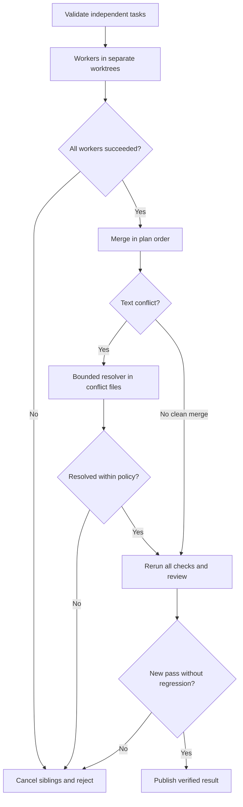

# Parallel workers and conflict resolution

ProofLoop 0.3 adds bounded concurrent worker processes, each in a separate detached Git worktree. All start from the last accepted commit. Codex workers and generic command workers (including a user-supplied Qwen wrapper) can share a plan. Git 2.38+ with `merge-tree --write-tree` is required for parallel execution.

## Try the offline demonstration

From the source checkout:

```bash
python -m proofloop parallel-demo
```

The demo runs two synthetic workers in isolated checkouts, merges their intentionally conflicting edits, invokes a deterministic resolver, and verifies `a+b` against a fixed check. It calls no provider and needs no API key or installed Codex. The planner process emulates the Codex JSONL/final-message interface; it is a fixture, not a model. Inspect the combined result with:

```bash
git -C .proofloop-parallel-demo diff main..proofloop/parallel-demo
python -m proofloop report .proofloop-parallel-demo/task.json --repo .proofloop-parallel-demo
```

## Prepare a real Codex task

```bash
proofloop init-codex --dir my-parallel-task \
  --planner-model gpt-6-astra --worker-model gpt-6.1-sol \
  --reviewer-model gpt-6-astra --parallel --max-parallel 2 \
  --resolver-model gpt-6-astra
proofloop doctor my-parallel-task/task.json --repo my-parallel-task
proofloop run my-parallel-task/task.json --repo my-parallel-task
```

Setup and `doctor` make no model calls. `run` can consume your allowance. The generated mean example is a small interface check; it does not need multiple workers. For a useful parallel task, substitute independent components and freeze meaningful checks. The planner may return fewer tasks than the maximum. Model availability and live CLI behavior depend on your installation and account.

Existing 0.2 configurations remain sequential unless `execution` is explicitly `parallel`. Add these fields inside `delegation`:

```json
{
  "execution": "parallel",
  "max_parallel": 2,
  "conflict_resolution": {
    "strategy": "resolve",
    "resolver": {
      "adapter": "codex",
      "model": "gpt-6-astra",
      "reasoning_effort": "medium",
      "timeout_s": 180
    },
    "max_attempts": 1
  }
}
```

This is a fragment: `planner`, `workers`, and `max_tasks` are still required. See the [complete mixed-provider template](../examples/codex/parallel-task.json). Add your own Qwen wrapper before using its profile. The resolver can also be a generic editing-capable command adapter. It receives the goal, task list, conflict paths, Git object IDs for both sides, and bounded retry feedback.

If conflict settings are omitted, or `strategy` is `reject`, a conflicted candidate is rejected without a resolver call. `--resolver-model` explicitly enables one resolver attempt per conflicted integration step. It requires `--parallel`, which requires a planner.

## Execution and integration



1. Validate the entire plan and confirm enough call slots remain for its workers.
2. Create separate worktrees at one accepted base. Run at most `max_parallel` workers concurrently (1–8; default 2). These processes have separate checkout files and indexes.
3. Check each worker's return status, HEAD, and path boundaries. Record its patch and an internal candidate commit. A worker failure signals running siblings to cancel and cancels queued jobs.
4. Wait for all worker processes before removing their worktrees. Any worker failure rejects the entire candidate.
5. Use Git's three-way merge engine and integrate commits in **plan order**, regardless of completion order. Clean merges are automatic; the integration checkout retains its original HEAD so the normal publication guard applies.
6. If configured, try supported text-conflict resolution. Then rerun every acceptance stage, check regressions/path policy, and request the configured review. Publishing uses the same compare-and-swap result-branch update as before.

## What the resolver may do

Only conflict paths may change. Nonconflicting files and frozen inputs/checks cannot be edited by the resolver. It cannot publish or change acceptance rules. Resolving a text conflict requires each affected file to exist as a regular file, change from the initial conflict version, and contain no detected conflict markers. A conservative marker scan can reject legitimate marker-like text; inspect that case manually.

Supported automatic resolution: UTF-8 text conflicts on regular files present on both sides with matching file modes, including ordinary add/add conflicts. Git must provide explicit conflicted paths and marker-bearing merged text. Binary, symlink, differing-mode, modify/delete, and complex rename/directory conflicts that do not meet this contract are rejected for review. There is no automatic `ours`/`theirs` selection. A clean merge can still contain a logical conflict; only the configured checks/reviewer can detect it.

A resolver can make at most `max_attempts` calls per conflicted integration step (1–3). With N workers, the upper bound is `(N-1) × max_attempts` resolver calls. A failed resolver call or scope violation rejects immediately. Remaining markers may receive another pass within the configured cap. The normal cumulative call and active-time budgets apply to every role.

When `budget.max_calls` is absent, the default includes the planner, workers, reviewer, and maximum configured resolver calls for each attempt. It is a cap on harness-issued invocations, not a hard provider billing guarantee. Concurrent reservations and state writes are serialized; process execution is concurrent. Reserved/interrupted calls remain visible with unknown usage.

## Evidence and recovery

Each attempt writes `parallel.json` with the base, plan order, worker intervals/results, merge sequence, and resolution results. `worker-N.patch` preserves each candidate, including rejected work. Per-worker prompts, logs, and JSON results stay separate. `merges/NN/` includes raw merge-tree output and resolver prompts/results. Internal commit IDs may eventually be garbage-collected; saved patches are the portable reconstruction evidence.

Ctrl+C requests cancellation, terminates active process groups on POSIX, waits for worker threads to finish, and then cleans up worktrees. Windows process cleanup is implemented but unvalidated. A forced process/machine crash may leave worktrees and a lock; follow [recovery](recovery.md). An interrupted batch is not resumed mid-merge: the next attempt starts at the last accepted commit and consumes the remaining budgets.

Worktrees share Git administration, credentials, external files, and host resources. They are not a security sandbox. Ignored files and external side effects are not merged, guarded, or rolled back. Use restricted hosts for untrusted commands. This release adds no distributed execution, direct inter-agent messaging, or real-model efficiency benchmark.
